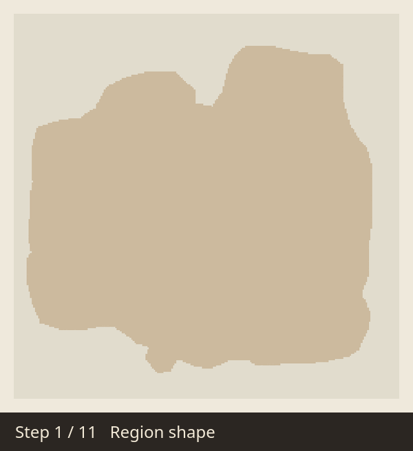
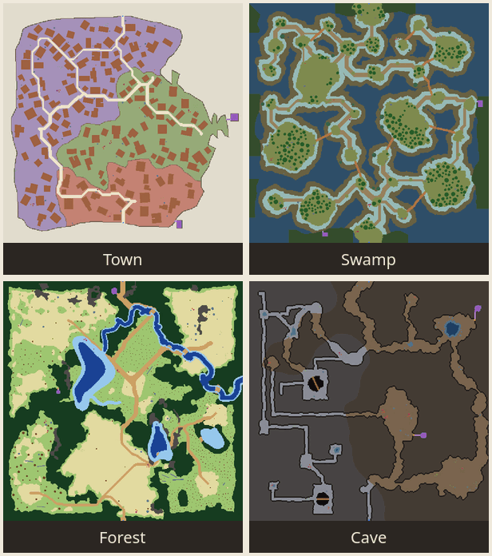

# mapTemplateGenerator

Make 2D map blueprints for ARPG levels in a few clicks. Hand the result to
an AI agent (or a level designer) to build a playable prototype fast.

  

Every map is built as a chain of steps, each one using the result of the
one before. Above, a town grows from its outline to houses, hidden rooms
and mobs.

> **⚠ Beta.** This is an early version. Settings and file formats may still
> change between releases. **Only the Town map kind is ready**; the others
> work end to end but are still being tuned.

| Map kind | What it builds | Status |
|---|---|---|
| **Town** | walls, districts, winding roads, gates, houses, props | ✅ ready |
| **Swamp** | islands, mud paths, boardwalks, water by depth, trees | 🧪 being tuned |
| **Forest** | wild and managed areas, rock ridges, streams, thickets, trails, trees | 🧪 being tuned |
| **Cave** | natural caverns and hand-dug mines, tunnels, chasms, pools | 🧪 being tuned |

Every kind also places props, interactive objects, hidden rooms and mobs.
The app opens on Forest for now; switch the kind in **1 · Template**.

  

## What you get

Each map is exported as three files:

- **map.png**: the colored map. Walls, roads, houses, props, mobs, gates
  and everything else each have their own color.
- **layer.png**: the same layout as machine-readable data, for tools and AI
  agents.
- **spec.json**: a legend plus the exact position and size of every
  object.

The same settings and the same seed always give the same map. Re-roll the
seed for a new variant.

## Download

Get the zip for **Windows** or **Linux** from the
[Releases page](https://github.com/NazarZubyk/mapTemplateGenerator/releases),
unzip it, and run `mapTemplateGenerator`. `QUICKSTART.md` in the zip covers
the details.

- **Windows** may warn "Windows protected your PC", because the app is not
  code-signed. Click **More info → Run anyway**.
- **Linux**: run `./mapTemplateGenerator` from the unzipped folder.

## How to use

1. In **1 · Template**, set the kind to **Town** and pick the map size. Maps
   can be up to 16 km on a side; for big maps raise the **Cell size** (the
   app warns when a map will take minutes and gigabytes of memory, and
   blocks sizes it cannot hold).
2. Go down the panel on the left. Each block is one step of the map, from
   the outline to walls, regions, roads, gates, houses, props, interactive
   objects, hidden rooms and mobs. Hover any setting to see what it does.
3. Press **⚙ Generate**. Press **🎲 Re-roll** for another variant. To move
   only the mobs, use **🎲 Re-roll mobs** in the Mobs block.
4. Drag or swipe to move the preview, and pinch or Ctrl+scroll to zoom.
5. Use **Export** to write the three files, and **Config file → Save**
   to keep your settings.

Not sure where to start? Every block has a **🎲 Random params** button.

## Let Claude set up the map (optional)

The download also includes `mapgen-mcp`, which lets
[Claude Code](https://claude.com/claude-code) change the settings for you.
Just describe what you want:

> *"Bandit camp: gates east and west, rats, bandits and a bandit chief, the
> chief never with rats, crowded."*

The open app picks up each change and regenerates. Setup takes one command;
see `QUICKSTART.md`.

## Known limitations (beta)

- Only **Town** is tuned. Swamp, Forest and Cave are complete but still
  being tuned; settings that cannot work as asked show a warning.
- The **walkable %** setting is not used yet.
- Few safety checks. For example, two object types with the same color are
  not flagged yet.
- Windows builds are not code-signed, so expect the SmartScreen warning.
- Huge maps export smaller images: map.png and layer.png stay within
  16384 px on a side (spec.json records the scale used).

Found a bug or have an idea? Open an
[issue](https://github.com/NazarZubyk/mapTemplateGenerator/issues).

## For developers

Building from source, project layout, the MCP tools and how to make a
release are in [docs/development.md](docs/development.md). How the
generator works, step by step, is in [docs/workflow.md](docs/workflow.md).
The requirements are in [docs/goals.md](docs/goals.md).
