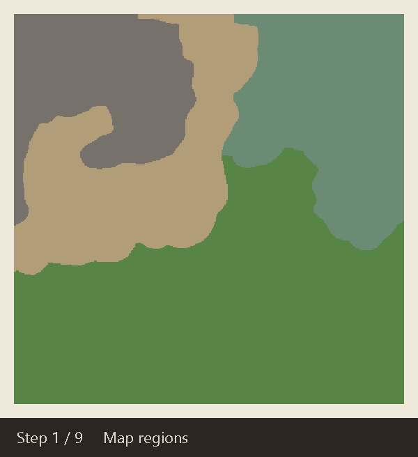
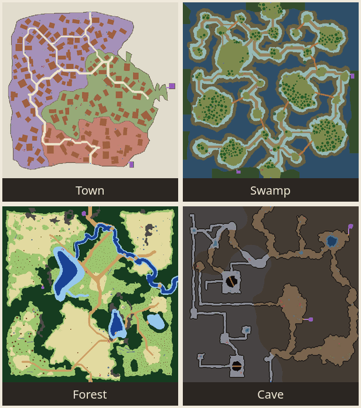
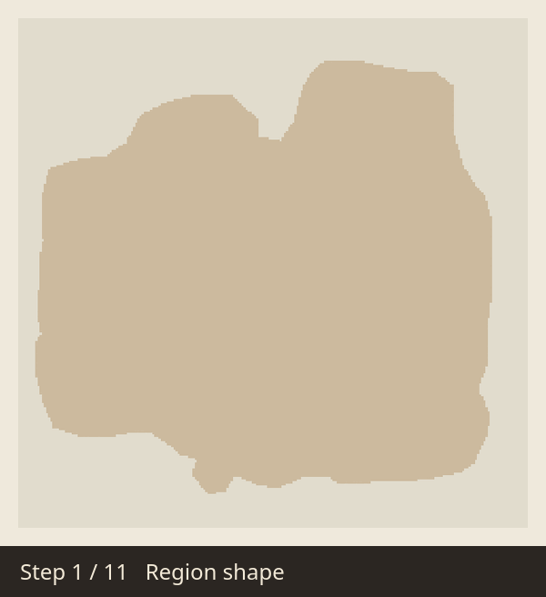

# mapTemplateGenerator

Make 2D map blueprints for ARPG levels in a few clicks. Hand the result to
an AI agent (or a level designer) to build a playable prototype fast.

  

One map, several kinds of land. The map is split into regions (a town, a
forest, a swamp, mountains with caves), each with its own settings. The
land, the rivers and the ways between the regions are shared, so they fit
together into one walkable map.

> **⚠ Beta.** This is an early version. Settings and file formats may still
> change between releases. **Only the Town map kind is ready**; the others
> work end to end but are still being tuned.

| Map kind | What it builds | Status |
|---|---|---|
| **Town** | walls, districts, winding roads, gates, houses, props | ✅ ready |
| **Swamp** | islands, mud paths, boardwalks, water by depth, trees | 🧪 being tuned |
| **Forest** | wild and managed areas, rock ridges, streams, thickets, trails, trees | 🧪 being tuned |
| **Cave** | natural caverns and hand-dug mines, tunnels, chasms, pools | 🧪 being tuned |
| **Mixed** | regions of the kinds above on one map; mountains are a massif with caves inside and passes over it | 🧪 new, being tuned |

Every kind also places props, interactive objects, hidden rooms and mobs.
The app opens on a Mixed map; switch the kind in **1 · Template**.

  

How a single map is built (town)

  

## What you get

Each map is exported as three files (a Mixed map adds a fourth):

- **map.png**: the colored map. Walls, roads, houses, props, mobs, gates
  and everything else each have their own color.
- **layer.png**: the same layout as machine-readable data, for tools and AI
  agents: every object, and the ground under it (roads, walls, water,
  walkable or not).
- **spec.json**: a legend plus the exact position and size of every
  object.
- **regions.png** (Mixed maps): which region each pixel belongs to, its
  kind, and whether it is walkable.

The same settings and the same seed always give the same map. Re-roll the
seed for a new variant.

## Download

Get the zip for **Windows** or **Linux** from the
[Releases page](https://github.com/NazarZubyk/mapTemplateGenerator/releases),
unzip it, and run `mapTemplateGenerator`. `QUICKSTART.md` in the zip covers
the details.

- **Windows** may warn "Windows protected your PC", because the app is not
  code-signed. Click **More info → Run anyway**.
- **Linux**: run `./mapTemplateGenerator` from the unzipped folder.

## How to use

1. In **1 · Template**, pick the kind and the map size. Maps can be up to
   16 km on a side; for big maps raise the **Cell size** (the app warns
   when a map will take minutes and gigabytes of memory, and blocks sizes
   it cannot hold).
2. Go down the panel on the left. Each block is one step of the map. Hover
   any setting to see what it does.
   - **Mixed**: list the regions in **Map regions** (kind, share of the
     map, placement), then set the land, rivers and connections. Pick a
     region under them to change its own settings: they are the same
     blocks as a map of that kind.
   - **Town** and the other kinds: from the outline to walls, districts,
     roads, gates, houses, props, interactive objects, hidden rooms and
     mobs.
3. Press **⚙ Generate**. Press **🎲 Re-roll** for another variant. To move
   only the mobs, use **🎲 Re-roll mobs** in the Mobs block (on a Mixed
   map, the picked region's mobs). Problems show in the warnings list;
   red ones, such as two things in the same color, must be fixed before
   you can generate.
4. Drag or swipe to move the preview, and pinch or Ctrl+scroll to zoom.
5. Use **Export** to write the files, and **Config file → Save** to keep
   your settings.

Not sure where to start? Every block has a **🎲 Random params** button.

## Let Claude set up the map (optional)

The download also includes `mapgen-mcp`, which lets
[Claude Code](https://claude.com/claude-code) change the settings for you.
Just describe what you want:

> *"Bandit camp: gates east and west, rats, bandits and a bandit chief, the
> chief never with rats, crowded."*

> *"A walled town in the middle of a big forest, a swamp to the south and
> mountains on the east edge; wolves in the forest, trolls in the caves."*

The open app picks up each change and regenerates. Setup takes one command;
see `QUICKSTART.md`.

## Known limitations (beta)

- Only **Town** is tuned. Swamp, Forest, Cave and Mixed are complete but
  still being tuned; settings that cannot work as asked show a warning.
- On a Mixed map the regions meet at sharp borders; land that blends from
  one kind into the next (trees in town yards, a wet forest edge by a
  swamp) is planned.
- Windows builds are not code-signed, so expect the SmartScreen warning.
- Huge maps export smaller images: map.png and layer.png stay within
  16384 px on a side (spec.json records the scale used).

Found a bug or have an idea? Open an
[issue](https://github.com/NazarZubyk/mapTemplateGenerator/issues).

## For developers

Building from source, project layout, the MCP tools and how to make a
release are in [docs/development.md](docs/development.md). How the
generator works, step by step, is in [docs/workflow.md](docs/workflow.md);
mixed maps in [docs/mixed-plan.md](docs/mixed-plan.md).
The requirements are in [docs/goals.md](docs/goals.md).
